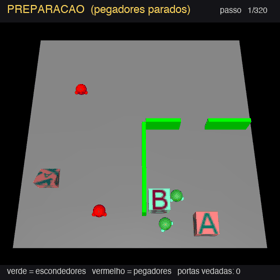
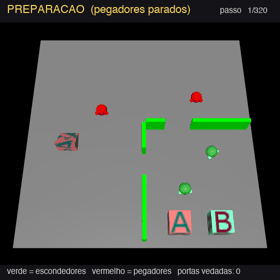
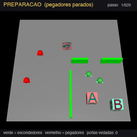
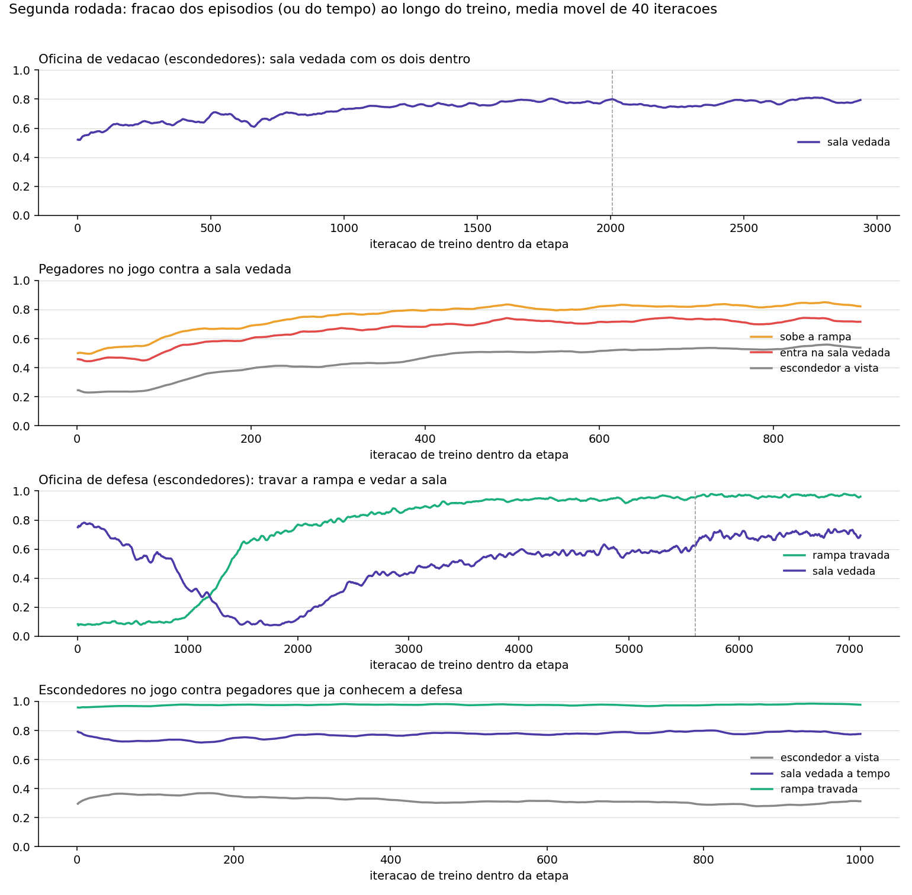
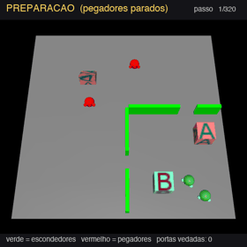
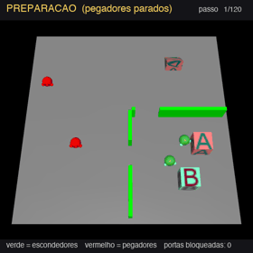
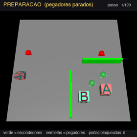
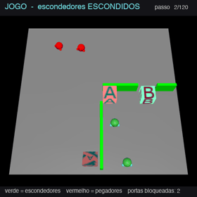
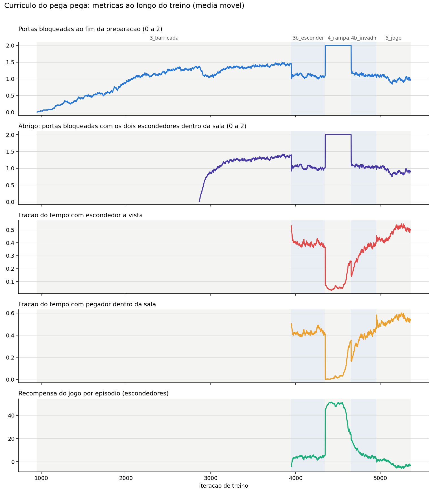

# Pega-pega: esconde-esconde multiagente com aprendizado por reforço

Trabalho de Inteligência Computacional (UFU). Dois times de agentes — **escondedores** e
**pegadores** — aprendem a jogar esconde-esconde em um mundo físico simulado, cada time
treinado por PPO contra o outro. O ambiente é o `hide_and_seek` da OpenAI
([multi-agent-emergence-environments](https://github.com/openai/multi-agent-emergence-environments),
do artigo *Emergent Tool Use from Multi-Agent Autocurricula*, Baker et al., 2019); o
treinamento, o currículo e as recompensas auxiliares são nossos.

No artigo original as estratégias (perseguir, construir barricadas, usar rampas) aparecem
sozinhas depois de centenas de milhões de episódios. Aqui o orçamento é o de um computador
pessoal, então o treino é guiado por um **currículo**: cada fase ensina uma habilidade com
recompensas auxiliares e só depois os dois times jogam livremente.

## Resultados

O treino foi feito em duas rodadas. A segunda, descrita aqui, chega a três etapas em
sequência, as mesmas três primeiras do artigo original:

| A. Barricada | B. Rampa | C. Defesa contra a rampa |
| --- | --- | --- |
|  |  |  |
| Os escondedores vedam as duas portas com as caixas e ficam dentro da sala. | Os pegadores respondem levando a rampa até a parede e pulando para dentro. | Os escondedores respondem saindo no começo da preparação, arrastando a rampa para longe, trancando-a e voltando antes de fechar a sala. |

Cada etapa é um checkpoint em `checkpoints_rodada2/`. O **modelo de demonstração** é o da
última, `etapa_c_defesa.pt`: é o que `tentar.py`, `avaliar.py` e `gravar_video.py` abrem por
padrão. Os GIFs acima são o melhor episódio de 20 em cada etapa.

Avaliação com 300 episódios por linha (`resultados/avaliacao_rodada2.json`), episódios de 320
passos do simulador (160 de preparação e 160 de jogo). O erro padrão é de cerca de 2 pontos.

| Etapa (checkpoint) | Escondedor à vista | Episódios sem ser visto | Sala vedada a tempo | Rampa travada | Pegador no alto da rampa | Pegador entra na sala vedada | Recompensa dos escondedores por passo |
| --- | --- | --- | --- | --- | --- | --- | --- |
| A. Barricada (`etapa_a_barricada.pt`) | 20% | 10% | 82% | 5% | 20% | 18% | +0,60 |
| B. Rampa (`etapa_b_rampa.pt`) | 63% | 2% | 82% | 6% | 88% | 78% | −0,25 |
| **C. Defesa** (`etapa_c_defesa.pt`), pegadores já treinados contra ela | **35%** | **6%** | **77%** | **98%** | **4%** | **4%** | **+0,29** |
| Escondedores de C contra os pegadores de B | 10% | 39% | 77% | 98% | 12% | 2% | +0,80 |
| Primeira rodada (`checkpoints_final/fase_4b_invadir.pt`, episódio de 120 passos) | 44% | 10% | 20% | 7% | 12% | 6% | +0,12 |

- **Sala vedada a tempo**: ao fim da preparação as duas portas estão vedadas e os dois
  escondedores estão dentro. A porta só conta como vedada se a caixa está trancada e
  encaixada no vão, sem sobra para um pegador passar (critério medido, ver adiante).
- **Rampa travada**: ao fim da preparação a rampa está trancada por um escondedor dentro da
  sala ou a mais de 0,9 m da parede dela. Só quem trancou pode destrancar.
- **Pegador entra na sala vedada**: fração dos episódios em que um pegador esteve dentro da
  sala com as duas portas vedadas.

O que os números dizem:

- **A barricada funciona.** Em A os escondedores vedam a sala a tempo em 82% dos episódios.
  Com a sala vedada eles são vistos em 13% do tempo; com ela aberta, em 56%.
- **A rampa derrota a barricada.** Em B os escondedores são os mesmos de A. Quando a sala
  está vedada, um pegador sobe a rampa em 84% dos episódios e entra em 83%, e o escondedor à
  vista vai de 20% para 63%.
- **Travar a rampa derrota a rampa.** Em C a rampa fica fora de uso em 98% dos episódios e os
  pegadores entram na sala vedada em 4%. Contra os pegadores de B, que só sabem a rampa, o
  escondedor à vista cai para 10%.
- **Os pegadores se adaptam à defesa, mas não a anulam.** Treinados contra ela, eles largam a
  rampa e passam a espiar pelas frestas das portas (a caixa de 0,5 m não tapa a visão pelo
  vão de 0,7 m) e a entrar quando a sala não fecha a tempo. Com a sala vedada os escondedores
  são vistos em 23% do tempo, quase tudo por pegador espiando de fora; com ela aberta, em
  73%. O resultado é 35% à vista, contra 63% sem a defesa.
- **A defesa custa vedação.** Um escondedor gasta o começo da preparação com a rampa, e a
  sala fecha a tempo em 77% dos episódios, contra 82% sem essa tarefa.



Cada painel é uma etapa do treino, na ordem em que foi feita. As linhas tracejadas marcam
uma troca de regra no meio da etapa: na oficina de vedação, o critério de porta vedada ficou
mais exigente; na oficina de defesa, a preparação passou de 120 para 160 passos. No terceiro
painel a vedação despenca quando os escondedores começam a sair para travar a rampa e se
recupera quando aprendem a voltar.

Vídeos em `resultados/videos/`:

| Arquivos | O que mostram |
| --- | --- |
| `etapa_a_barricada_ep1..2.mp4` | etapa A: os 2 episódios com a sala vedada e os escondedores menos vistos, entre 30 jogados |
| `etapa_b_rampa_ep1..2.mp4` | etapa B: os 2 episódios com uso de rampa mais claro entre 30 |
| `etapa_c_defesa_ep1..2.mp4` | etapa C: os 2 melhores episódios de defesa entre 30 (rampa travada, sala vedada, escondedores não vistos) |
| `variante_porta_estreita_ep1..2.mp4` | variante de porta estreita: os 2 melhores episódios de defesa entre 30 |
| `etapa_c_sem_selecao_ep1..3.mp4` | etapa C: 3 episódios seguidos, sem escolher. Nos dois primeiros a defesa sai completa (à vista 14% e 41% do tempo, por pegador espiando); no terceiro uma porta fica aberta e os pegadores entram |

A segunda rodada levou cerca de 7 h 30 min de relógio em um MacBook de 12 núcleos, só com
CPU, quase sempre com dois treinos em paralelo (10,8 horas somando os treinos). Foram 22 961
iterações, contando as tentativas descartadas. A linhagem dos modelos finais soma cerca de
13 500 iterações novas para os escondedores e 2 300 para os pegadores, perto de 41 milhões de
decisões de ambiente. A variante de porta estreita, descrita mais abaixo, somou outra 1 h 45 min.

## O que mudou na segunda rodada

A primeira rodada terminou com barricada e rampa aparecendo pouco (ver "Primeira rodada").
A segunda partiu dos checkpoints dela (`fase_3_barricada.pt` para os escondedores,
`fase_4_rampa.pt` para os pegadores) e mudou o seguinte:

1. **Porta vedada de verdade.** O critério antigo (caixa trancada a até 0,45 m do centro da
   porta) aceitava caixa deslocada, e a sala "fechada" vazava: contando só portas sem
   passagem, o modelo da primeira rodada veda a sala em 20% dos episódios, não em 35%. O
   critério novo foi medido no jogo: com a caixa a mais de 0,28 m da linha da parede ou a
   mais de 0,13 m do centro do vão, os pegadores passavam pela sobra em 16–19% dos episódios
   vedados. Com esses limites o vazamento ficou em 0–2%. A recompensa passou a usar o
   critério novo (`vedar_porta`) e a mirar a caixa meio encaixada no vão (`alvo_porta`).
2. **Posição relativa às portas na observação.** Só com recompensa, a vedação parou em 55%
   dos episódios da oficina: as falhas eram erros de precisão (caixa trancada um pouco de
   lado, torta, mexida depois de pronta). A rede só recebia coordenadas absolutas. Com a
   posição do agente e das caixas medida a partir de cada porta (opção `obs_portas`, 18
   entradas a mais), a vedação chegou a 80%. A rede já treinada é aproveitada: as entradas
   novas começam com peso zero.
3. **Episódio de 320 passos nas fases de jogo.** Na primeira rodada eram 120. Com a sala
   fechada, os pegadores da oficina sobem a rampa em 74% dos episódios com 60 passos de jogo
   e em 91% com 120; e a defesa contra a rampa precisa de 160 passos de preparação para a
   sala fechar a tempo (74% dos episódios, contra 58% com 120). As três etapas usam a mesma
   duração para a comparação ser justa.
4. **Pegadores treinados contra uma sala que fecha.** Na primeira rodada eles desaprendiam a
   rampa no jogo (uso na oficina caía de 74% para 11%), porque quase sempre havia uma porta
   aberta. Contra escondedores que vedam em 80% dos episódios, a rampa passa a ser o caminho
   e o uso sobe sozinho de 63% para 88%.
5. **Aquecimento do crítico ao trocar de fase.** Ao ligar a recompensa do jogo, os
   escondedores perdiam a vedação (de 76% para 59% em 1 000 iterações). Passou a haver
   algumas dezenas de iterações em que só a estimativa de valor é treinada (`--aquecer`),
   taxa de aprendizado menor e lotes maiores.
6. **Defesa contra a rampa**, a etapa que mais precisou de ajuda:
   - todos os agentes passam a saber sempre onde a rampa está (opção `obs_rampa`, 6 entradas
     a mais). No ambiente original ela só aparece para quem a enxerga, e de dentro da sala
     os escondedores não a veem. É uma simplificação em relação ao ambiente da OpenAI;
   - enquanto a rampa não está travada, vedar portas e ficar na sala não rendem nada. Sem
     isso os escondedores se fechavam e nunca saíam (fora da sala em 5% do tempo);
   - a aproximação da rampa é medida pelo caminho que passa por uma porta livre. Em linha
     reta o escondedor ficava empurrando a parede;
   - depois de travar a rampa, quem ficou fora é puxado de volta para a porta livre mais
     próxima, e fechar a última porta livre com o colega do lado de fora custa caro. Sem
     isso a rampa era travada em 66% dos episódios, mas a sala só fechava em 10%.

Tentativas da segunda rodada que não entraram no resultado: três variantes da oficina de
vedação antes da observação nova (pararam entre 45% e 55%); dois treinos de jogo dos
escondedores (um piorava a vedação, o outro não trazia ganho); um treino de pegadores contra
escondedores que só tinham passado pela oficina (os pegadores trocaram a rampa por espiar,
porque esses escondedores não se escondem das frestas); e duas versões da oficina de defesa
antes das mudanças do item 6.

Para repetir, em resumo (a execução real teve as interrupções descritas acima, e parte do
treino dos pegadores foi feita com episódios de 240 passos):

```bash
# 1. oficina de vedação (escondedores)
python treinamento.py --pasta r2/vedar --iniciar-de checkpoints_final/fase_3_barricada.pt --fase 8 --obs-portas --envs 24 --iters 5000
# 2. pegadores no jogo, contra a sala vedada
python juntar.py --escondedores r2/vedar/checkpoint_recente.pt --pegadores checkpoints_final/fase_4_rampa.pt --saida r2/invadir/inicio.pt --fase 10 --horizonte 320
python treinamento.py --pasta r2/invadir --iniciar-de r2/invadir/inicio.pt --aquecer 60 --lr 1e-4 --passos 320 --iters 900
# 3. oficina de defesa contra a rampa (escondedores)
python treinamento.py --pasta r2/defender --iniciar-de r2/vedar/checkpoint_recente.pt --fase 12 --obs-rampa --envs 24 --ent 0.01 --iters 4000
python treinamento.py --pasta r2/defender --envs 24 --iters 3000
# 4. escondedores no jogo, contra os pegadores da etapa 2
python juntar.py --escondedores r2/defender/checkpoint_recente.pt --pegadores r2/invadir/checkpoint_recente.pt --saida r2/jogo/inicio.pt --fase 13 --horizonte 320
python treinamento.py --pasta r2/jogo --iniciar-de r2/jogo/inicio.pt --envs 24 --aquecer 40 --lr 1e-4 --passos 320 --iters 1000
```

## Variante: porta do tamanho da caixa

Na etapa C os escondedores ainda são vistos em 35% do tempo por dois motivos: a caixa de 0,5 m
não tapa o vão de 0,7 m, e a sala não fecha a tempo em 23% dos episódios. Mais treino no mesmo
cenário não mudou isso (600 iterações a mais levaram de 32% para 29% e pararam). Para testar o
primeiro motivo há uma variante do ambiente em que a porta tem um vão de 0,5 m, a largura da
caixa (`--tam-porta 1`; o padrão da OpenAI é 2). A caixa então não entra no vão: encosta na
parede por dentro e tapa a porta inteira.

|  |
| --- |
| Melhor episódio de 20 da variante (`checkpoints_rodada2/variante_porta_estreita.pt`). |

Só a etapa C foi adaptada à variante: 2 296 iterações da oficina de defesa para os
escondedores e 285 iterações de jogo para os pegadores, partindo dos modelos da etapa C.
Avaliação com 300 episódios de 320 passos:

| | Etapa C (porta padrão) | Variante (porta estreita) |
| --- | --- | --- |
| Escondedor à vista | 35% | 23% |
| Episódios sem ser visto | 6% | 30% |
| À vista com a sala vedada | 23% | 9% |
| À vista com a sala aberta | 73% | 48% |
| Sala vedada a tempo | 77% | 58% |
| Rampa travada | 98% | 99% |
| Pegador entra na sala vedada | 4% | 3% |
| Recompensa dos escondedores por passo | +0,29 | +0,53 |

- **A porta tapada quase acaba com a espiada.** Com a sala vedada os escondedores são vistos em
  9% do tempo, contra 23%, e em 30% dos episódios não são vistos nenhuma vez.
- **A vedação a tempo é menor, e o critério é outro.** Aqui a porta só conta como vedada com
  fresta de no máximo 8 cm; na porta padrão o critério é não sobrar passagem para um agente.
  Os dois números (58% e 77%) não medem a mesma coisa. Ainda assim há porta aberta de fato:
  um pegador fica dentro da sala em 22% do tempo de jogo.
- **Continua longe de 100%.** O que falta é fechar a sala a tempo em todos os episódios. A
  oficina de defesa parou em cerca de 57% nessa geometria.
- **Os pegadores tiveram pouco treino aqui.** Nas 285 iterações contra a variante eles não
  acharam resposta nova (à vista ficou em 25%); um treino mais longo poderia achar.

## Primeira rodada

Esta seção descreve o primeiro treino completo, com episódios de 120 passos e as métricas
daquela rodada ("duas portas fechadas" usa o critério antigo, que aceitava caixa deslocada).


| Barricada (`fase_4b_invadir.pt`) | Rampa no jogo (`fase_4b_invadir.pt`) | Rampa (fim da oficina) |
| --- | --- | --- |
|  |  |  |

O modelo de demonstração desta rodada é o `checkpoints_final/fase_4b_invadir.pt` (4 956
iterações), salvo ao fim da fase `4b_invadir`: é o checkpoint em que a barricada e a rampa
aparecem juntas. O fim do currículo (`checkpoint_recente.pt`, depois de mais 400 iterações de
jogo livre) fica na tabela para comparação.

Cada linha é um checkpoint avaliado em 300 episódios (`resultados/avaliacao.json`), com as
regras da fase em que foi salvo. O erro padrão das porcentagens é de cerca de 2 pontos.

| Checkpoint | Escondedor à vista | Episódios sem ser visto | Duas portas fechadas a tempo | Abrigo (0 a 2) | Pegador no alto da rampa | Recompensa dos escondedores por passo |
| --- | --- | --- | --- | --- | --- | --- |
| Treino original, 17 257 iterações (`checkpoints_curriculo/checkpoint_recente.pt`) | 78% | 0% | 0% | 0,01 | 4% | −0,56 |
| Fim de `3_barricada` (oficina, sem jogo) | — | — | 56% | 1,41 | — | — |
| Fim de `3b_esconder` | 41% | 11% | 31% | 1,00 | 1% | +0,18 |
| Fim de `4_rampa` (oficina, sala já fechada) | — | — | — | — | 73% | — |
| **Modelo de demonstração da rodada**: fim de `4b_invadir`, 4 956 iterações (`checkpoints_final/fase_4b_invadir.pt`) | **44%** | **10%** | **35%** | **1,08** | **12%** | **+0,12** |
| Fim do currículo (`5_jogo`), 5 356 iterações (`checkpoints_final/checkpoint_recente.pt`) | 58% | 6% | 26% | 0,92 | 3% | −0,16 |

"Escondedor à vista" é a fração do tempo de jogo, contada por passo do simulador (são 2 por
decisão). "Pegador no alto da rampa" é a fração dos episódios em que algum pegador chegou a
0,5 m de altura. "A tempo" quer dizer ao fim da preparação.

- **As barricadas apareceram.** Os escondedores levam as caixas até as portas, trancam e
  ficam dentro da sala. No `fase_4b_invadir.pt` a sala fica fechada com os dois lá dentro
  em 38% do tempo de jogo; nesse tempo eles são vistos em 22% dos passos, e no resto, em 56%.
- **A rampa foi aprendida na oficina.** Com a sala já fechada, os pegadores sobem a rampa
  em 73% dos episódios e entram na sala em 69%.
- **No jogo, a rampa é pouco usada.** No `fase_4b_invadir.pt` algum pegador sobe a rampa
  em 12% dos episódios, e o tempo com pegador dentro de uma sala fechada passa de 7% (antes
  da oficina) para 16%.
- **O jogo livre favoreceu os pegadores.** Nas 400 iterações de `5_jogo` o uso da rampa cai
  para 3% dos episódios e o escondedor à vista sobe de 44% para 58%. Os pegadores melhoraram
  principalmente quando a sala não está fechada (à vista de 56% para 68% desse tempo), e os
  escondedores passaram a fechar a sala menos vezes (de 38% para 27% do tempo de jogo). Por
  isso o modelo escolhido nesta rodada é o checkpoint anterior, e não o último.

A linha do treino original foi medida no ambiente original (agarrar com o sinal antigo e
`frame_skip=4`); as demais, no ambiente corrigido com `frame_skip=2`. Antes da oficina de
rampa existia outro fim de currículo (`checkpoints_final/final_sem_oficina_rampa.pt`): com
as regras atuais ele fica com escondedor à vista 52% do tempo e −0,04 por passo.



O gráfico cobre as fases treinadas de novo (iterações 951 a 5 356). A queda em "portas
bloqueadas" perto da iteração 2 860 é o momento em que a recompensa passou a valer só para
barricadas feitas por dentro (item 4 da seção sobre o que estava impedindo as barricadas).
No gráfico, "escondedor à vista" é o valor registrado durante o treino, contado por decisão
(só entra a decisão em que o escondedor é visto nos 2 passos do simulador); ele fica de 4 a
5 pontos abaixo da contagem por passo usada na tabela.

Vídeos em `resultados/videos/`:

| Arquivos | O que mostram |
| --- | --- |
| `demo_escondidos_ep1..3.mp4` | `fase_4b_invadir.pt`: os 3 melhores episódios para os escondedores entre 30 jogados |
| `demo_sem_selecao_ep1..3.mp4` | `fase_4b_invadir.pt`: 3 episódios seguidos, sem escolher (dois com a sala fechada e escondedores vistos em menos de 5% do tempo, um sem barricada) |
| `jogo_livre_escondidos_ep1..3.mp4` | fim do currículo: os 3 melhores episódios para os escondedores entre 30 jogados |
| `jogo_livre_sem_selecao_ep1..3.mp4` | fim do currículo: 3 episódios seguidos, sem escolher (dois perdidos pelos escondedores, um empatado) |
| `oficina_rampa_ep1..2.mp4` | fim da oficina: pegador leva a rampa até a parede e entra na sala fechada |
| `rampa_no_jogo_ep1..2.mp4` | `fase_4b_invadir.pt`: os 2 episódios com uso de rampa mais claro entre 60 jogados |
| `treino_original_ep1..2.mp4` | o modelo do treino original, para comparação |

O treino das fases 3 a 5 somou 2 h 50 min em um MacBook de 12 núcleos, só com CPU (4 406
iterações). Para repetir:

```bash
python treinamento.py --pasta checkpoints_final --iniciar-de checkpoints_curriculo/fase_2_perseguir.pt --fase 3 --frame-skip 2 --envs 24 --iters-fase-final 400
```

## O jogo

- Arena de 6 m × 6 m com uma sala de 3 m × 3 m em um canto. A sala tem duas portas em
  posições sorteadas a cada episódio.
- 2 escondedores nascem dentro da sala, com 2 caixas. 2 pegadores nascem fora. Há 1 rampa,
  em posição sorteada.
- **Preparação**: na primeira metade do episódio os pegadores ficam parados. É o tempo que os
  escondedores têm para se organizar. O episódio tem 120 passos do simulador na primeira
  rodada e 320 na segunda.
- **Recompensa do jogo** (a cada passo, depois da preparação): pegadores ganham +1 se algum
  deles enxerga um escondedor e −1 caso contrário; escondedores recebem o oposto.
- Cada agente escolhe a cada decisão: força em x, força em y e giro (11 níveis cada),
  **agarrar** (segura a caixa ou rampa que estiver na frente e perto) e **trancar** (fixa no
  chão o objeto ao lado; só o agente que trancou destranca).
- A visão é um cone de 135° bloqueado por paredes, caixas e rampa.

## Instalação

Precisa de Python 3.10. Com [uv](https://docs.astral.sh/uv/):

```bash
uv venv --python 3.10 .venv
```

```bash
uv pip install --python .venv/bin/python -r requirements.txt
```

Com `pip` puro: crie um ambiente virtual de Python 3.10 e rode `pip install -r requirements.txt`.

Não é preciso instalar o `mujoco_py` nem o MuJoCo 2.1 à mão: a pasta `compat/` traduz as
chamadas do `mujoco_py` para o pacote oficial `mujoco`, que tem instalador para Windows,
Linux e macOS (inclusive Apple Silicon). Se o `mujoco_py` original estiver instalado, ele é
usado; para forçar a camada de compatibilidade, defina `PEGAPEGA_MUJOCO=compat`.

## Como usar

Todos os comandos rodam na raiz do repositório, com o ambiente virtual ativado
(`source .venv/bin/activate`, ou `.venv\Scripts\activate` no Windows).

| O que fazer | Comando |
| --- | --- |
| Ver o modelo de demonstração (etapa C) jogando em uma janela | `python tentar.py` |
| Ver outra etapa | `python tentar.py --ckpt checkpoints_rodada2/etapa_b_rampa.pt` |
| Medir o modelo de demonstração (200 episódios) | `python avaliar.py` |
| Comparar as três etapas | `python avaliar.py --todos` |
| Gravar vídeos sem abrir janela | `python gravar_video.py` |
| Gravar só os melhores episódios de defesa | `python gravar_video.py --melhores 2 --de 30 --destaque defesa` |
| Ver um modelo da primeira rodada | `python tentar.py --ckpt checkpoints_final/fase_4b_invadir.pt` |
| Desenhar as curvas de treino | `python graficos.py --rodada2 checkpoints_rodada2/treinos` e `python graficos.py --csv checkpoints_final/historico.csv` |
| Juntar escondedores de um checkpoint com pegadores de outro | `python juntar.py --escondedores a.pt --pegadores b.pt --saida c.pt --fase 13` |
| Treinar do zero (primeira rodada) | `python treinamento.py --pasta minha_pasta --frame-skip 2` |

Opções úteis do `treinamento.py`: `--envs N` (ambientes em paralelo; 24 ocupa bem 12
núcleos), `--fase N` (força uma fase do currículo), `--iniciar-de arquivo.pt` (parte dos
pesos de outro checkpoint), `--iters N` (para depois de N iterações), `--horizonte N`
(passos do simulador por episódio), `--passos N` (decisões coletadas por ambiente a cada
iteração), `--aquecer N` (N iterações treinando só a estimativa de valor), `--lr`, `--ent` e
`--peso time:componente=valor` (trocam taxa de aprendizado, entropia e pesos de recompensa),
`--obs-portas` e `--obs-rampa` (alargam a observação), `--tam-porta` e `--tam-caixa` (mudam
a geometria; só `--tam-porta 1` foi treinado). O treino salva
`checkpoint_recente.pt` a cada 10 iterações, um `fase_<nome>.pt` ao fim de cada fase e
acrescenta uma linha por iteração em `historico.csv`. `Ctrl+C` salva antes de sair.

`tentar.py`, `avaliar.py` e `gravar_video.py` aceitam `--fase N` para aplicar as regras de
outra fase (de 1 a 13, na ordem das tabelas do currículo), `--horizonte N` para mudar a
duração do episódio e `--det` para usar sempre a ação mais provável.

## Como funciona

### Agente

`ActorCriticLSTM` em `ppo.py`: camada densa (256) → LSTM (256) → duas cabeças, a
política (5 escolhas discretas independentes) e o valor. Os dois escondedores compartilham
uma rede e os dois pegadores compartilham outra. A observação de cada agente tem 92
números: a própria posição e velocidade, os outros agentes, as caixas e a rampa (zerados
quando fora do campo de visão) e a posição das portas. Na segunda rodada ela ganha 18
números com a posição do agente e das caixas medida a partir de cada porta (`obs_portas`) e
6 com a posição e o estado da rampa, sempre visíveis (`obs_rampa`).

### Treino

PPO com GAE (γ = 0,99, λ = 0,95), retropropagação truncada em trechos de 20 passos,
recompensa normalizada pelo desvio do retorno e parada antecipada por divergência KL.
Os ambientes rodam em processos paralelos. Cada decisão do agente é repetida por
`frame_skip` passos do simulador.

### Currículo

| Fase | Quem treina | O que se quer | Passa de fase quando |
| --- | --- | --- | --- |
| `1_explorar` | os dois times | andar pela arena | 30 células visitadas por agente |
| `2_perseguir` | os dois times | pegadores perseguem, escondedores fogem (só movimento) | escondedor à vista 65% do tempo |
| `3_barricada` | escondedores | fechar as portas com as caixas e ficar dentro da sala, com os pegadores parados o episódio todo | abrigo médio de 1,5 porta |
| `3b_esconder` | escondedores | fazer a barricada dentro do tempo de preparação e ficar escondido | abrigo médio de 1,2 porta |
| `4_rampa` | pegadores | oficina de rampa: a sala já começa fechada e os escondedores ficam parados; só se entra levando a rampa até a parede e pulando | pegador dentro da sala 35% do tempo |
| `4b_invadir` | pegadores | usar a rampa no jogo de verdade, contra os escondedores treinados | escondedor à vista 55% do tempo |
| `5_jogo` | os dois times | jogo completo, com a recompensa do jogo no comando | — |

"Abrigo" é o número de portas fechadas por caixa trancada **com os dois escondedores dentro
da sala** quando a preparação termina (de 0 a 2). Cada fase também tem um teto de iterações.

O time que não treina fica congelado com a política da fase anterior. Em cada fase só as
ações já ensinadas ficam liberadas; as outras são mascaradas na ação neutra. Os pegadores
nunca recebem a ação de trancar: sem treino específico eles trancariam a rampa em qualquer
lugar, e para subir basta encostá-la na parede.

Fases da segunda rodada (não avançam sozinhas: cada uma é rodada com `--fase N` e `--iters`):

| Fase (`--fase`) | Quem treina | O que se quer |
| --- | --- | --- |
| `6_vedar` (8) | escondedores | oficina: vedar as duas portas de verdade e ficar dentro, em 120 passos |
| `7_esconder` (9) | escondedores | o mesmo no jogo, contra pegadores |
| `8_invadir` (10) | pegadores | jogo contra escondedores que vedam a sala: usar a rampa |
| `9_jogo` (11) | os dois times | jogo livre com as recompensas novas (não usada no resultado) |
| `10_defender` (12) | escondedores | oficina: travar a rampa longe da sala, voltar e vedar, em 160 passos |
| `11_esconder_defender` (13) | escondedores | o mesmo no jogo, contra pegadores que usam a rampa |

### Recompensas auxiliares

Quase todas são **diferenças de potencial** (ganha-se pelo progresso feito no passo, perde-se
ao desfazê-lo), o que orienta o aprendizado sem criar um objetivo diferente do jogo.

| Componente | Para quem | Mede |
| --- | --- | --- |
| `jogo` | todos | recompensa original do esconde-esconde |
| `novidade` | todos | +1 ao entrar em uma célula de 0,5 m ainda não visitada |
| `distancia` | todos | escondedor se afastando do pegador mais próximo (e o inverso) |
| `ir_caixa` | escondedores | aproximação da caixa livre atribuída a ele |
| `encarar` | todos | virar de frente para a caixa (escondedor) ou rampa (pegador): sem isso não dá para agarrar |
| `caixa_porta` | escondedores | caixas chegando mais perto das portas |
| `trancar_porta` | escondedores | número de portas cobertas por caixa trancada, contado só para quem está dentro da sala |
| `trancar_longe` | escondedores | penalidade por caixa trancada longe de porta (ela não pode mais ser movida) |
| `na_sala` | escondedores | estar dentro da sala |
| `portas_fechadas` | escondedores | pago a cada passo pelas portas já fechadas, para premiar quem fecha cedo (não é potencial) |
| `ir_rampa` | pegadores | aproximação da rampa |
| `lado_baixo` | pegadores | estar do lado baixo da rampa (de onde dá para empurrá-la e subir) |
| `rampa_parede` | pegadores | rampa chegando perto da parede da sala |
| `rampa_mira` | pegadores | lado alto da rampa virado para a parede da sala |
| `altura` | pegadores | altura do pegador (subir na rampa); quem já pulou para dentro conta como altura cheia |
| `dentro_sala` | pegadores | +1 por passo com um pegador dentro da sala |
| `alvo_porta` | escondedores | (rodada 2) caixas chegando ao ponto em que vedam o vão, meio encaixadas nele |
| `vedar_porta` | escondedores | (rodada 2) número de portas vedadas de verdade, contado só para quem está dentro da sala |
| `portas_vedadas` | escondedores | (rodada 2) pago a cada passo pelas portas já vedadas (não é potencial) |
| `ir_rampa_h` | escondedores | (rodada 2) aproximação da rampa pelo caminho que passa por uma porta livre, para o escondedor mais próximo dela |
| `rampa_travada` | escondedores | (rodada 2) rampa trancada dentro da sala ou a mais de 0,9 m da parede dela |
| `voltar` | escondedores | (rodada 2) depois de travar a rampa, aproximação da porta livre mais próxima para quem está fora |
| `colega_fora` | escondedores | (rodada 2) penalidade enquanto não há porta livre e há um escondedor do lado de fora |

## O que estava impedindo as barricadas

O primeiro treino completo (pasta `checkpoints_curriculo/`, 17 mil iterações) terminou com
os escondedores bloqueando 0,02 porta por episódio e sendo vistos 73% do tempo no registro
do próprio treino (78% na contagem por passo da tabela acima). A causa
não era o algoritmo, e sim quatro problemas no caminho:

1. **Agarrar arremessava a caixa.** O ambiente da OpenAI prende a caixa ao agente com uma
   restrição de solda e grava nela o vetor "agente − caixa". Essa era a convenção do MuJoCo
   1.5; do MuJoCo 2.1 em diante a engine espera "caixa − agente". Com o sinal trocado, ao
   agarrar a caixa era puxada para o lado oposto do agente e saía voando. Um agente
   roteirizado (anda até a caixa, agarra, arrasta até a porta, tranca) bloqueava 0,17 porta
   por episódio com a convenção antiga e 1,63 com o sinal corrigido. A correção está em
   `mae_envs/wrappers/manipulation.py`: a função `sinal_da_solda()` simula dois corpos na
   primeira chamada e descobre qual convenção vale na engine instalada.
2. **Controle grosseiro.** Com `frame_skip=4` a força máxima desloca o agente cerca de 1,6 m
   por decisão em uma sala de 3 m, e agarrar exige estar a 25 cm da caixa e de frente para
   ela. O mesmo agente roteirizado cai de 1,48 porta (`frame_skip=2`) para 0,72
   (`frame_skip=4`). As fases de manipulação passaram a usar `frame_skip=2`.
3. **Sinal de aprendizado fraco.** A barricada era ensinada junto com o jogo, cuja recompensa
   (±1 por passo) abafava as auxiliares, e nada desencorajava trancar a caixa em qualquer
   lugar. Daí a fase `3_barricada` sem pegadores, a penalidade `trancar_longe` e o incentivo
   `encarar`.
4. **Barricada pelo lado de fora.** Com os três itens acima resolvidos, os escondedores
   passaram a fechar 1,4 porta por episódio — arrastando a caixa atrás de si através da
   porta, onde ela entalava, e ficando trancados para fora da própria sala (só 0,08 porta
   fechada com os dois dentro). A recompensa media a porta coberta, não quem estava
   protegido. Com `trancar_porta` valendo só para quem está dentro e o potencial `na_sala`,
   o abrigo passou de 0,02 para 1,16 em 340 iterações.

As fases 1 e 2 do treino original só usam movimento e não foram afetadas; o treino novo
(`checkpoints_final/`) parte de `checkpoints_curriculo/fase_2_perseguir.pt`.

## A oficina de rampa

Na primeira versão do treino novo os pegadores tinham 400 iterações para reagir à barricada
e não aprenderam nada: como os escondedores só fecham a sala em parte dos episódios, quase
nunca valia a pena mexer na rampa. A fase `4_rampa` virou uma oficina, como a da barricada:

- **Sala já fechada.** O ambiente começa com uma caixa trancada em cada porta (opção
  `sala_fechada`), a rampa do lado de fora e os escondedores parados lá dentro.
- **Um agente roteirizado mostrou que dá.** Levando a rampa até a parede e subindo, ele
  entra na sala em 25 de 30 episódios. Isso validou a física antes de gastar treino.
- **O atalho das frestas.** O vão da porta tem 0,7 m e a caixa 0,5 m. Com a recompensa do
  jogo ligada, em 150 iterações os pegadores aprenderam a se encaixar na porta e espiar os
  escondedores parados pelas frestas (à vista 75% do tempo, sem nunca entrar). A oficina
  ficou só com as recompensas de rampa e de entrar na sala.

## Estrutura do repositório

| Caminho | Conteúdo |
| --- | --- |
| `treinamento.py` | ponto de entrada do treino (junta os dois módulos abaixo) |
| `ambiente.py` | ambiente de dois times, recompensas auxiliares, currículo e processos paralelos (não carrega o PyTorch, para cada processo de simulação ocupar pouca memória) |
| `ppo.py` | rede, PPO, checkpoints e laço de treino |
| `avaliar.py` | métricas de um checkpoint em N episódios |
| `tentar.py` | visualização em janela |
| `gravar_video.py` | vídeos MP4/GIF sem janela |
| `juntar.py` | monta um checkpoint com os escondedores de um arquivo e os pegadores de outro |
| `graficos.py` | curvas de treino a partir do `historico.csv` |
| `preparar_ambiente.py` | caminhos, escolha do MuJoCo e remendos para NumPy/Gym atuais |
| `compat/mujoco_py/` | API do `mujoco_py` implementada sobre o pacote oficial `mujoco` |
| `mujoco-worldgen/`, `multi-agent-emergence-environments/` | cópias dos projetos da OpenAI, com pequenos ajustes |
| `checkpoints_final/` | primeira rodada: checkpoints por fase, histórico e log |
| `checkpoints_rodada2/` | segunda rodada: um checkpoint por etapa (A, B e C), o da variante de porta estreita e os históricos de treino em `treinos/` |
| `checkpoints_curriculo/` | treino original (antes da correção do agarrar) |
| `checkpoints/` | pesos de uma versão anterior da rede, incompatíveis com o código atual |
| `resultados/` | gráficos, vídeos e tabela de avaliação |

### Ajustes nas cópias dos projetos da OpenAI

- `mae_envs/wrappers/manipulation.py`: correção do sinal da solda (acima) e conversão das
  ações para vetor NumPy.
- `mae_envs/wrappers/prep_phase.py`, `mae_envs/wrappers/util.py`: compatibilidade com tuplas
  do Gym 0.26.
- `mujoco_worldgen/builder.py`, `env.py`, `parser/normalize.py`: carregamento do modelo por
  arquivo, sementes de 31 bits e tipos numéricos do NumPy atual.

## Limitações

- **As etapas são checkpoints separados, não um jogo livre.** Cada etapa junta um time
  treinado contra o outro congelado, na ordem do currículo. Não houve treino longo dos dois
  times ao mesmo tempo, e as estratégias seguintes do artigo original (pegadores subindo em
  caixas) não foram tentadas.
- **A defesa contra a rampa teve mais ajuda que as outras etapas.** Os agentes sabem sempre
  onde a rampa está, e a ordem "primeiro a rampa, depois a sala" está embutida na recompensa
  da oficina. A estratégia foi ensinada, não descoberta pelos agentes.
- **A defesa deixa a sala aberta em 23% dos episódios.** Quando isso acontece os pegadores
  entram, e é daí que vem a maior parte do tempo à vista da etapa C.
- **Duração do episódio escolhida para as estratégias caberem.** Com 240 passos, que foi a
  duração usada em parte do treino, a etapa C veda a sala a tempo em cerca de 58% dos
  episódios. O ambiente da OpenAI usa 80 passos, com agentes treinados por muito mais tempo.
- **Variante de porta estreita só na etapa C.** As etapas A e B não foram refeitas nela, os
  pegadores treinaram só 285 iterações contra ela e uma caixa maior que o vão (`--tam-caixa`)
  foi testada só sem treino: os agentes atuais não transferem para ela.
- **Etapa A com pegadores de um treino curto.** Os pegadores de `etapa_a_barricada.pt` vêm
  de um treino descartado de 800 iterações; espiam pelas frestas e usam a rampa em 20% dos
  episódios. Eles não foram treinados de novo contra os escondedores finais dessa etapa.
- **Números da primeira rodada com outro critério.** A tabela da primeira rodada usa "duas
  portas fechadas" pelo critério antigo, e as curvas dela contam "à vista" por decisão. Só a
  linha "Primeira rodada" da tabela principal foi medida de novo com as métricas atuais.
- **Frestas.** A caixa não tapa o vão inteiro da porta, então um pegador encostado na porta
  às vezes enxerga para dentro mesmo com a sala fechada.
- **Uma única execução por rodada.** Não houve repetição com outras sementes, então não há
  medida da variação entre treinos.
- **A fase 3 não foi treinada de uma vez.** Foram três trechos, com a recompensa ajustada
  entre eles: 1 500 iterações sem `na_sala` e sem `portas_fechadas`, 414 com
  `portas_fechadas` e 6 épocas de PPO por atualização (antes eram 4), e 1 086 com a
  recompensa final. Repetir o comando da primeira rodada treina a fase inteira já com a recompensa final,
  e o resultado pode ser diferente. A fase `4_rampa` também foi interrompida e retomada, com
  24, 12 e 16 ambientes paralelos, porque a máquina estava ocupada com outros trabalhos.
- **O código das fases antigas mudou um pouco.** `trancar_longe` e `ir_caixa` agora usam o
  critério novo de caixa no vão. Treinar de novo as fases da primeira rodada com o código
  atual não reproduz exatamente as recompensas daquela execução.
- **Fases 1 e 2 com outro `frame_skip`.** Elas vêm do treino original (`frame_skip=4`) e não
  têm histórico em CSV; as fases seguintes usam `frame_skip=2`.
- **MuJoCo 2.1 não foi testado aqui.** Tudo rodou com o pacote `mujoco` 3.17 pela camada
  `compat/`, em macOS com Apple Silicon. A convenção da solda foi conferida no código-fonte
  do MuJoCo 2.2.1 e medida no MuJoCo 3; como `sinal_da_solda()` testa a engine instalada, a
  correção se ajusta sozinha a qualquer versão. Windows e Linux não foram testados.
- **Vídeos.** `gravar_video.py` só funciona com a camada `compat/` (pacote `mujoco`).
